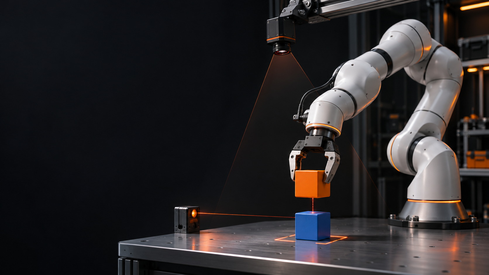
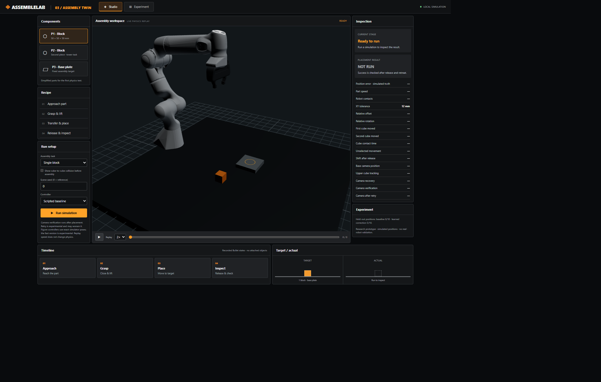
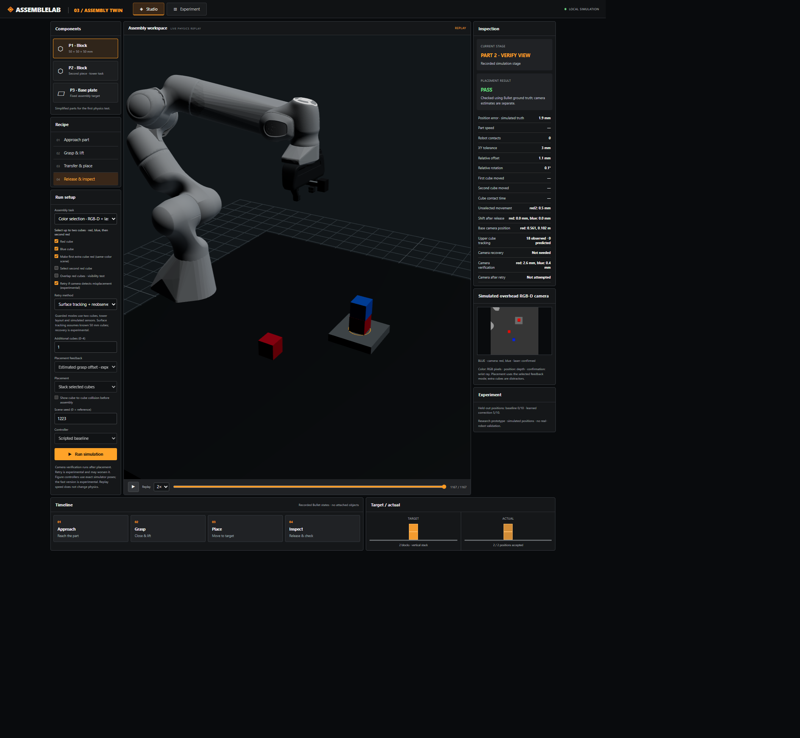
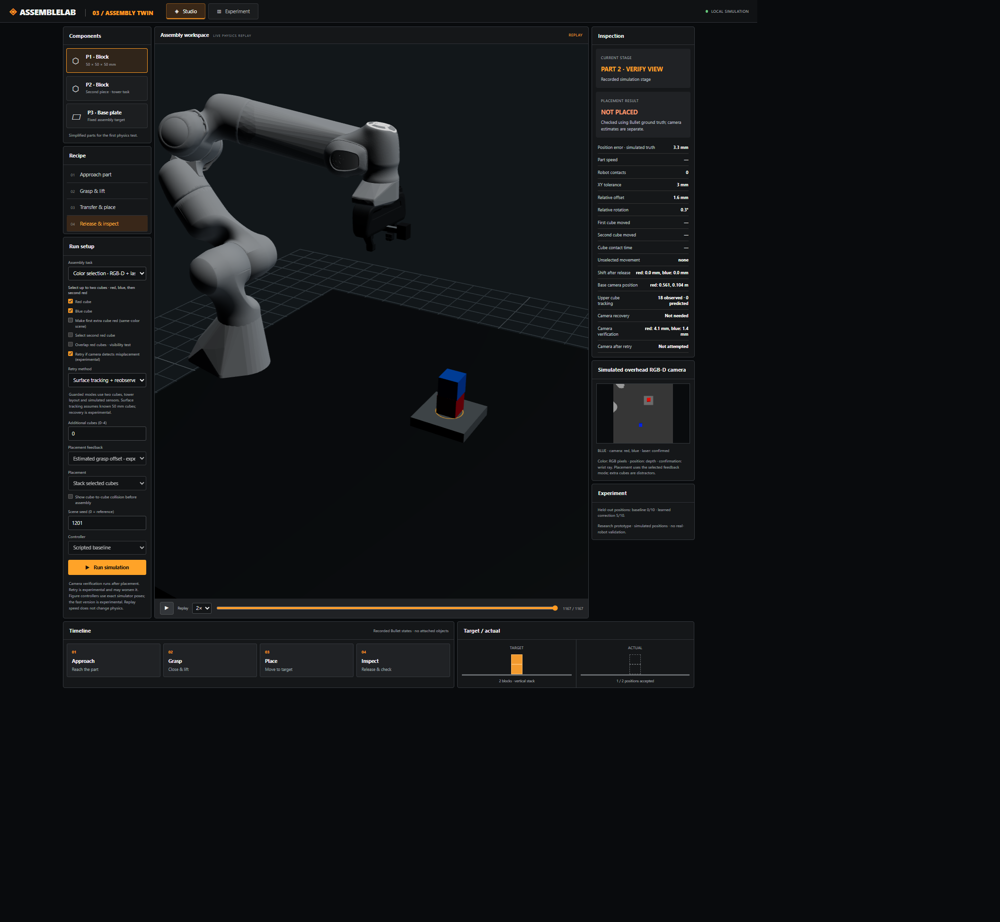

# AssembleLab

**A local robotics research prototype for selecting colored blocks and stacking them with simulated vision and contact feedback.** Explore the actual Bullet simulation, inspect a replay and compare the controller's estimate with simulation ground truth.

> **Research prototype.** The tower controller is programmed, not an end-to-end learned policy. Camera, laser and contact readings are simulated. The project has not been tested on physical hardware and must not be used to control a real robot.

## What it does

- Simulates a Franka Panda arm, a parallel gripper, a base plate and colored cubes in PyBullet. The cubes are free dynamic bodies; there is no object-to-gripper attachment constraint.
- Finds selected colors using an overhead simulated RGB-D camera and confirms candidate positions using a wrist-mounted ray. Optional experimental controllers use side views and contact checks while positioning the upper cube.
- Records Bullet states for a browser replay in Three.js. The inspection panel shows camera measurements, final outcomes and ground-truth checks separately.
- Provides single-block, two-block, color-selective and optional collision demonstrations. Some controllers use exact simulator poses; read the mode labels before comparing them.


*Studio: choose a task and controller, replay the simulation, and inspect placement metrics.*

## What we measured

In six newly specified paired simulated tower scenes, the previous two-view method passed **1/6**, while the optional surface-tracking method passed **2/6**, using the same strict checks for placement, angle, stability, support and disturbance of other blocks. The previous method stopped once because the camera estimates conflicted; the surface method did not stop in these six cases.

For the five scenes completed by both methods, relative XY alignment was better in all five. This is a small, conditional result with known 50 mm blocks and idealized sensors, not a general success rate. The recovery waypoint was **not invoked** in those six trials: mocked tests exercise it, but its effectiveness in a naturally occurring conflict remains unproven.

| Evaluation | Previous | Surface tracking | Evidence |
| --- | ---: | ---: | --- |
| Complete towers | 1/6 | 2/6 | [Raw paired results](outputs/surface-v1-new-scenes.json) |
| Camera-conflict stops | 1/6 | 0/6 | Same six scenes |
| Relative XY offset, five matched completions | 2.05, 2.61, 3.29, 0.50, 2.81 mm | 1.58, 1.35, 1.70, 0.21, 1.76 mm | Same matched scenes, not all six |


*Successful example: seed 1223, one additional same-color cube, surface tracking and retry. One successful example is not a reliability claim.*


*Unsuccessful example: seed 1201, no additional cubes, surface tracking and retry. Close relative alignment alone does not satisfy all placement checks.*

## Run locally

**Windows installation using Miniforge/Conda:**

```powershell
conda env create -f environment.yml
conda activate assemblelab
python server.py
```

Open [http://127.0.0.1:8810/](http://127.0.0.1:8810/). The server binds to localhost. Keep the terminal open while using the application. Alternatively, after creating the environment, run `start-local.cmd` from a terminal that can access `conda`.

The environment uses Python 3.11, PyBullet 3.25 and NumPy 2.4.6 from conda-forge. The browser runtime and Panda visual meshes are included; asset provenance is documented in [docs/ASSET_SOURCES.md](docs/ASSET_SOURCES.md). The Conda environment is installed separately and is not included in the repository. First installation needs network access and several hundred megabytes.

To reproduce the two examples, choose **Color selection · RGB-D + laser**, then **Surface tracking + reobserve**, enable retry, and use the scene settings in the captions above. A run can take time because the server computes the simulation before replaying it.

## Verification and research record

```powershell
conda activate assemblelab
python -m unittest discover -s tests
```

The [experiment history](docs/EXPERIMENT_HISTORY.md) preserves the chronological record, including unsuccessful approaches. The [frozen surface-tracking manifest](work/frozen-surface-v1/manifest.json) records the scene inputs and code hashes. [Raw results](outputs/surface-v1-new-scenes.json) contain individual checks and observations. Earlier work also includes a learned ridge-regression correction for a **single block**; it is separate from the programmed tower controller.

## Limitations

- A research simulation with idealized sensors, known cube dimensions and limited position, shape and clutter coverage. Visual tracking can fail under occlusion, wrong segmentation or changed orientation.
- Success is evaluated using Bullet ground truth. Sensor estimates and their errors are distinct from final physical checks in the simulator.
- Recovery and contact checks are experimental and are not a real-world safety system. Recorded scene results are too few to estimate deployment reliability.
- Browser replay performance varies by machine. The interface is designed for desktop; a phone-sized layout has not been validated. Installation has been checked only on the tested Windows environment; other operating systems are not verified.

## Project and third-party licensing

A project-wide license has not been selected. Third-party components retain their own licenses; see [asset sources](docs/ASSET_SOURCES.md). The banner is an illustration, not a screenshot of a physical robot.
